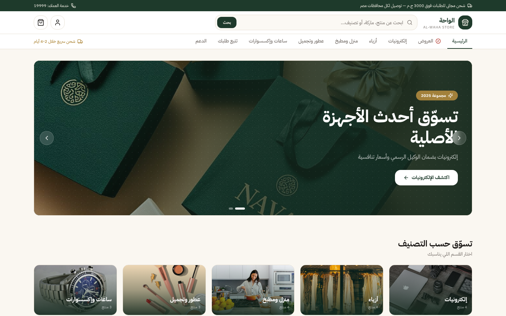

# 🛍️ Al-Waha Store

**A complete Arabic e-commerce storefront — five departments, coupons, wishlist and a full checkout flow.**

## 📖 Overview

Al-Waha is a full-scale Arabic e-commerce storefront with five departments — electronics, furniture and kitchen, fashion, perfumes and beauty, plus an offers hub. Every product carries ratings, review counts and discount campaigns; the cart tracks a free-shipping threshold, coupon codes like `WELCOME10` apply instantly, and category pages ship with filtering and sorting that feel native.

## ✨ Features

- 🏬 **Five departments** and 20+ product listings with rich detail cards
- 🔎 **Filtering, sorting** and instant search across the catalog
- 🛒 **Cart, wishlist and coupon-code checkout** with free-shipping progress
- ⭐ **Discount badges, star ratings** and review counts on every product
- 📌 **Persistent top bar** with delivery promise and account access

## 🧱 Tech Stack

`Next.js` · `E-Commerce` · `PostgreSQL` · `Prisma` · `Arabic RTL`

## 🌐 Live Product

**Try it now:** [https://e-commerce-hamzatalal.vercel.app/](https://e-commerce-hamzatalal.vercel.app/)

---

Built by **[Hamza Talal](https://github.com/{USERNAME})** — 15-year-old full-stack developer from Egypt

